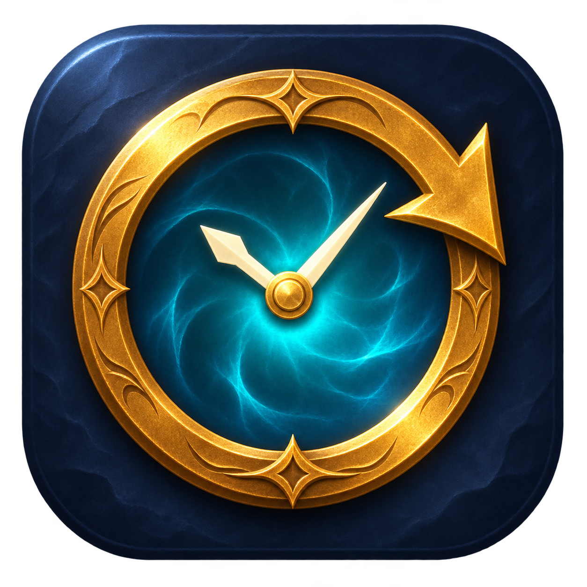

# Faction Retry



A macOS app that retries World of Warcraft character creation while a faction is restricted by population imbalance. Prepare your character once, set a retry interval, and start the app.

The app uses your current name and character options. It presses **Finish**, reads the response, and dismisses the known imbalance dialog. It confirms the dialog is gone before continuing. The default interval is two minutes and can be changed in the app.

Before submitting, the app reads the full prepared name. After a submission, two consecutive character-list readings containing that full name stop retries. The app leaves you at character selection.

## Build and run

Requires an Apple Silicon Mac, macOS 14 or newer, Python 3, and Xcode Command Line Tools.

```sh
git clone https://github.com/krozgrov/faction-retry.git
cd faction-retry
python3 build.py --test --output '/Applications/WoW Character Retry.app'
open '/Applications/WoW Character Retry.app'
```

The installed app is currently named **WoW Character Retry**. Quit an existing copy before rebuilding. Build outside cloud-synced folders, which can attach metadata that interferes with app signing.

1. Leave WoW windowed with your chosen character and name ready. Keep the window visible and fully on one display.
2. Approve Screen Recording and Device Control/Accessibility for the installed app when requested.
3. Set the interval and press **Start**. An existing imbalance dialog can stay open.

Use **Read screen** to check recognition without sending clicks. Expand **What the app sees (no clicks)** to inspect the captured image and text.

Press **Stop** or **Shift–Command–period** to stop. Stop the app before editing your character yourself. The app can bring WoW forward when an attempt is due.

The default game path targets **WoW: Forever**. Check the WoW path and Battle.net version label under **More settings** for your installation.

## Errors and recovery

Unknown messages, disconnected sessions, and failed recognition pause the run. After pressing Finish, the app waits up to 30 seconds for a recognized response and then pauses without submitting again.

Recognized throttle errors trigger a longer cooldown. Optional Battle.net recovery quits WoW normally, waits, verifies the selected game version, and clicks Play. It then pauses so you can restore any unsaved character options. Cooldowns and attempt times survive app restarts.

See the [user guide](docs/USER_GUIDE.md) for settings and permission troubleshooting. Rebuilding the locally signed app can invalidate earlier macOS permission approvals.

## Privacy

Screen images stay in memory and are processed locally with Apple Vision. The app captures the visible display area occupied by WoW or Battle.net; keep other windows out of that area. It does not save screenshots, upload screen data, store credentials, or modify game files. No API key is needed.

## Test status

Version 2.0.2 passed 56 automated checks covering screen recognition, retry timing, success detection, cooldowns, and OCR worker failures. Live testing verified a creation attempt, recognition and dismissal of the imbalance dialog, confirmation that it had closed, and return to the countdown.

Successful creation and throttle-triggered Battle.net recovery have not been observed in live testing. A cursor or text caret over a name can interfere with the optional name check and cause a pause.

## Source

The app is written in Swift with SwiftUI, ScreenCaptureKit, and Vision. `Sources/Core.swift` contains the recognition and timing rules; `Sources/App.swift` runs the interface and retry loop. `Sources/ScreenAccess.swift` handles capture and clicks, and `Sources/OCRHelper.swift` runs text recognition. Tests are in `Tests/`; `build.py` compiles, tests, and locally signs the app.

Faction Retry is an independent project and is not affiliated with Blizzard Entertainment.
